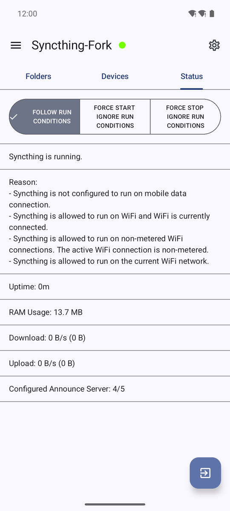
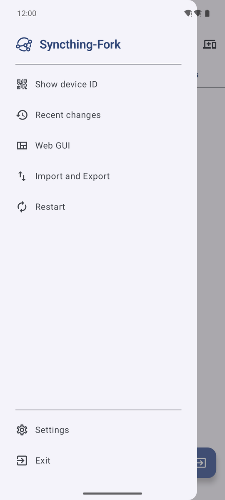
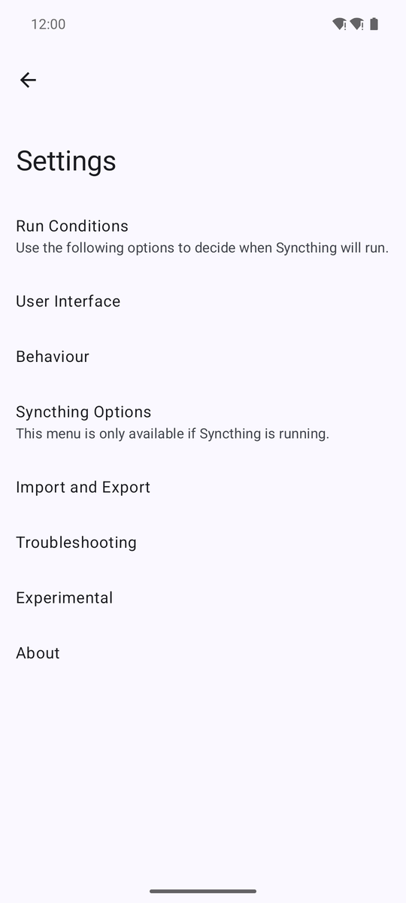

# Synchro

Application Android qui fait tourner [Syncthing](https://syncthing.net) sur le téléphone et le pilote
depuis une interface native. Syncthing synchronise des dossiers entre appareils, en direct et sans
serveur central. L'application lance le binaire officiel de Syncthing comme un processus et lui parle
par son API REST locale.

<p align="center">
  
  
  
</p>

Captures prises par la CI sur un émulateur Android 15, interface en anglais.

## Ce que fait l'application

- Liste des dossiers et des appareils, avec la progression de la synchronisation de chacun.
- Ajout, modification et suppression d'un dossier ou d'un appareil, que Syncthing tourne ou non.
  Un appareil s'ajoute en scannant son code QR.
- Conditions d'exécution : Wi-Fi, réseaux Wi-Fi choisis, données mobiles, Wi-Fi facturé, itinérance,
  mode avion, source d'alimentation, économiseur d'énergie, synchronisation automatique d'Android.
  Elles se règlent aussi dossier par dossier et appareil par appareil.
- Synchronisation planifiée, par exemple quelques minutes toutes les heures. L'onglet Statut dit
  pourquoi Syncthing tourne ou non.
- Changements récents, avec ouverture du fichier ou du dossier concerné.
- Partage de fichiers vers un dossier synchronisé depuis les autres applications, et prise de photos
  directement dans un dossier.
- Tuiles de réglages rapides, démarrage au démarrage du téléphone, pilotage par diffusion d'intents
  (`fr.kvngch.synchro.action.START`, `STOP` et `FOLLOW`).
- Import et export de la configuration dans une archive, chiffrée si un mot de passe est donné.
- Certificat HTTPS personnalisé pour l'interface web de Syncthing, qui reste accessible depuis
  l'application.
- Thème clair, sombre ou celui du système. Interface traduite dans une trentaine de langues.

## État

Le code vient de Syncthing-Fork, lui-même dérivé de l'application officielle
[syncthing-android](https://github.com/syncthing/syncthing-android), aujourd'hui arrêtée. Ce dépôt
est une version indépendante.

L'application a été réécrite en Kotlin et Jetpack Compose (Material 3) en octobre 2026 : plus de
Java, plus de layout XML, ni AppCompat ni bibliothèques héritées. Le suivi est dans
[#73](https://github.com/kvngch/syncthing-android/issues/73).

Cette version n'a pas encore été essayée sur un téléphone. Elle est vérifiée par le build, le lint,
des tests unitaires et des captures sur un émulateur Android 15, à chaque pull request. La variante
release, minifiée par R8, se construit et démarre sur cet émulateur. Aucune release n'est publiée pour
l'instant.

L'application s'appelle Synchro, identifiant `fr.kvngch.synchro`. Elle s'installe à côté de
Syncthing-Fork sans reprendre ses réglages : ceux-ci passent par l'export puis l'import de la
configuration.

## Essayer

La CI produit un APK de debug signé avec une clé de test publique, dans l'artefact
`signed-fr.kvngch.synchro` de chaque run de
[Build App](https://github.com/kvngch/syncthing-android/actions/workflows/build-app.yaml) (compte
GitHub requis pour le télécharger). Son identifiant se termine par `.debug`. Deux applis qui font
tourner Syncthing ne peuvent pas le faire en même temps, la première occupant le port de l'interface
web.

## Permissions

| Permission | Usage |
| --- | --- |
| Accès à tous les fichiers (Android 11 et plus), stockage avant | Lire et écrire les dossiers synchronisés |
| Notifications | Notification permanente du service, demandes de partage d'appareils et de dossiers |
| Exemption d'optimisation de la batterie | Garder Syncthing actif en arrière-plan |
| Localisation, y compris en arrière-plan | Lire le nom du Wi-Fi, pour la condition « réseaux Wi-Fi choisis » seulement |
| Appareil photo | Scanner un code QR, prendre une photo dans un dossier |
| Réseau local, multidiffusion Wi-Fi | Découvrir les appareils Syncthing du réseau local |

L'application ne collecte rien. Syncthing lui-même peut envoyer des rapports d'utilisation anonymes si
on l'accepte : voir sa [documentation](https://docs.syncthing.net).

## Construire

Le build compile Syncthing (Go) et ses bibliothèques natives pour quatre ABI avec le NDK, puis
l'application. Prérequis : JDK 21, Go, Python 3 et le SDK Android.

```bash
git clone --recursive https://github.com/kvngch/syncthing-android.git
cd syncthing-android
python3 scripts/install_minimum_android_sdk_prerequisites.py
export ANDROID_HOME="$PWD/../syncthing-android-prereq"
./gradlew buildNative
./gradlew lintDebug testDebugUnitTest assembleDebug
```

`minSdk` 26 (Android 8), `targetSdk` 37. Syncthing est en sous-module, à la version v2.1.7-rc.2.

## Licence

[MPL-2.0](LICENSE). Merci aux mainteneurs successifs du code d'origine :
[nutomic](https://github.com/nutomic), [imsodin](https://github.com/imsodin) et
[Catfriend1](https://github.com/Catfriend1).
